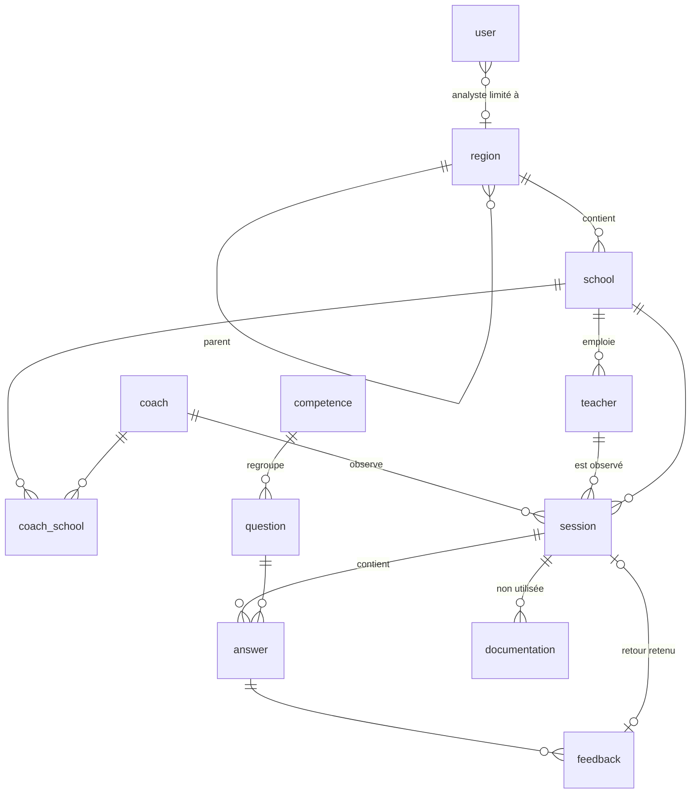
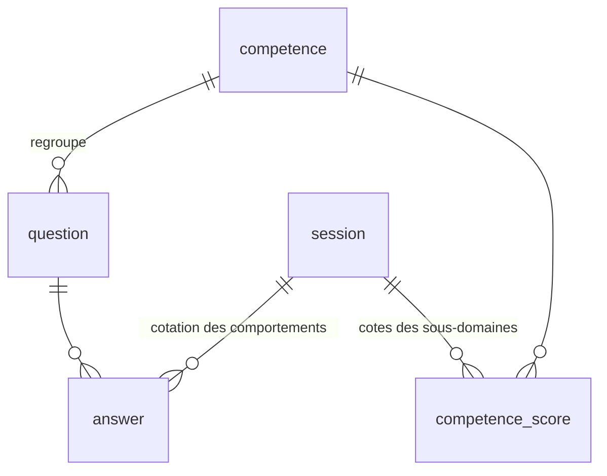
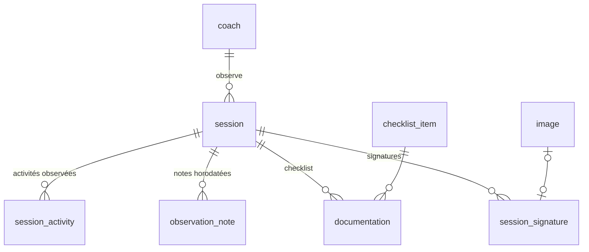
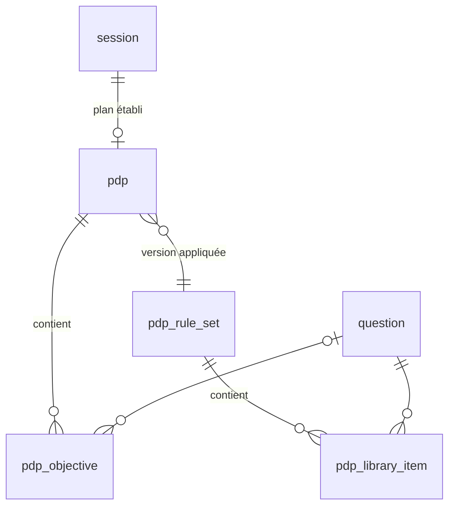
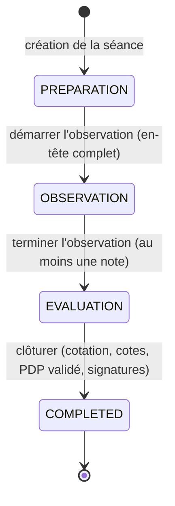

# Modèle de données étendu

Cette page décrit le modèle de données de Coach Digital tel qu'il existe aujourd'hui, puis les extensions nécessaires à l'outil d'observation de classe de la RDC. Elle constitue la partie « modèle de données » du livrable de la phase 2 (architecture technique étendue).

Sources :

- l'audit du code des dépôts `coach-backend` (entités TypeORM, PostgreSQL) et `coach-mobile` (schéma SQLite, service de synchronisation) ;
- l'outil d'observation au format papier (annexe B des TDR) et son manuel d'utilisation (annexe C) ;
- les hypothèses de conception du rapport de cadrage (section 6) et le backlog priorisé (B01 à B32).

## Principes de conception

1. **Étendre plutôt que remplacer.** Les entités existantes (`session`, `competence`, `question`, `answer`, `documentation`, `image`) sont conservées et complétées. Les nouvelles colonnes sont facultatives (`nullable`), de sorte que les données et les écrans existants continuent de fonctionner.
2. **Un même modèle sur le serveur et sur l'appareil.** Chaque table existe à l'identique dans PostgreSQL (serveur) et dans SQLite (application mobile). Les identifiants sont des UUID générés sur l'appareil, ce qui permet de créer des données hors ligne sans conflit. Côté mobile, chaque table garde la colonne technique `_status`, qui indique si la ligne a été synchronisée.
3. **Des référentiels configurables.** La grille (sous-domaines et comportements), la liste des documents à vérifier et les règles du PDP sont des données gérées dans l'administration, et non des valeurs écrites dans le code. Elles sont transmises aux appareils par la synchronisation existante.
4. **Des données de terrain traçables.** Les informations qui peuvent changer après coup sont recopiées dans la séance au moment de l'observation : fonction de l'observateur, version des règles utilisée pour le PDP, diagnostic obtenu. Une modification ultérieure du référentiel ne modifie pas une observation déjà réalisée.

## Modèle existant

Le schéma ci-dessous reprend les entités utilisées par le déroulement actuel de l'observation (Sierra Leone et Népal).

Constats utiles pour la suite :

- `competence` correspond à un sous-domaine et `question` à un comportement observable. `question.type` vaut toujours `option` et `question.scale` fixe le nombre d'étoiles. Les descriptions des niveaux sont stockées en JSON dans `question.tooltip_data`.
- `answer.value` est un entier ; il n'existe ni réponse Oui/Non, ni « N/A », ni cote globale par sous-domaine.
- `session.session_status` existe dans les deux bases mais n'est jamais renseigné.
- `documentation` existe côté serveur seulement ; elle n'est ni utilisée, ni synchronisée.
- `image` stocke des images en base64 et est déjà synchronisée : elle sera réutilisée pour les signatures.

## Modèle étendu

Les deux schémas ci-dessous montrent les relations ; les colonnes sont détaillées dans la section suivante. Les tables nouvelles sont marquées « (nouvelle) » dans les titres de cette section.

### Grille et cotation

### Déroulement de la séance

### Plan de Développement Professionnel

Toutes les tables, nouvelles ou existantes, gardent les colonnes `created_at`, `updated_at` et `deleted_at` (suppression logique), utilisées par la synchronisation.

## Détail des modifications

### Grille d'observation : `competence` et `question`

La grille de l'annexe B compte six sous-domaines et 30 comportements. Un sous-domaine reste une ligne de `competence`, un comportement une ligne de `question`.

| Table | Colonne ajoutée | Rôle |
| --- | --- | --- |
| `competence` | `code` | Numéro du sous-domaine dans l'outil papier : `I`, `II.1`, `II.2`, `III.1`, `III.2`, `IV` |
| `competence` | `domain_code`, `domain_title` | Domaine de rattachement, pour l'affichage groupé : `II` « Culture de la classe », `III` « Enseignement » |
| `competence` | `display_order` | Ordre d'affichage |
| `competence` | `has_global_score` | Indique si le sous-domaine reçoit une cote globale de 1 à 5 |
| `question` | `code` | Numéro du comportement : `1.1` à `4.6` |
| `question` | `display_order` | Ordre d'affichage dans le sous-domaine |
| `question` | `type` (existante) | Nouvelles valeurs : `YES_NO` (Oui/Non) et `FME` (Faible/Moyen/Élevé). La valeur `option` reste valable pour les grilles existantes |
| `question` | `allow_na` | Indique si la réponse « N/A » est proposée |
| `question` | `tooltip_data` (existante) | Descriptions des niveaux Faible, Moyen et Élevé tirées du manuel, dans le format JSON déjà utilisé par l'aide contextuelle |

Dans l'annexe B, la cote de 1 à 5 figure pour les sous-domaines II.1, II.2, III.1 et IV, mais pas pour I et III.2 : `has_global_score` vaut donc `false` pour ces deux sous-domaines (point à confirmer avec le SERNAFOR).

Répartition des types de réponse selon l'annexe B :

| Type | Comportements |
| --- | --- |
| Oui/Non | 1.1 |
| Oui/Non avec N/A | 1.3 |
| F/M/E avec N/A | 1.2, 2.1.3, 3.2.1, 3.2.3 |
| F/M/E | tous les autres |

### Réponses : `answer`

| Colonne | Rôle |
| --- | --- |
| `value` (existante) | Code de la réponse : pour `YES_NO`, `0` = Non et `1` = Oui ; pour `FME`, `1` = Faible, `2` = Moyen, `3` = Élevé |
| `not_applicable` (ajoutée) | `true` quand l'observateur choisit « N/A » ; `value` est alors vide |

Ce codage garde des entiers dans `value`, ce qui préserve les statistiques et l'export XLSX existants.

### Cote globale des sous-domaines : `competence_score` (nouvelle)

Une ligne par sous-domaine coté et par séance.

| Colonne | Rôle |
| --- | --- |
| `session_id`, `competence_id` | Séance et sous-domaine (couple unique) |
| `suggested_value` | Cote de 1 à 5 proposée par l'application |
| `value` | Cote retenue par l'observateur, de 1 à 5 |

La cote proposée est calculée à partir des comportements cotés du sous-domaine, hors N/A : avec Faible = 1, Moyen = 2 et Élevé = 3, la moyenne `m` donne la cote `arrondi(2 × m − 1)`. Un sous-domaine entièrement faible est ainsi proposé à 1, entièrement moyen à 3 et entièrement élevé à 5. Comme le précise le manuel, la cote n'a pas à être un calcul mathématique : l'observateur peut la modifier, et l'écart entre `suggested_value` et `value` reste visible.

### En-tête et déroulement : `session`

| Colonne ajoutée | Champ de l'outil papier |
| --- | --- |
| `level` | Niveau : PS, P ou S |
| `school_year` | Année scolaire (ex. `2026-2027`) |
| `teacher_weekly_load` | Charge hebdomadaire de l'enseignant (heures) |
| `last_observation_date`, `last_observation_rating` | Dernière observation : date et appréciation |
| `observer_function` | Fonction de l'observateur au moment de la séance (copie de `coach.function`) |
| `start_time`, `end_time` | Heures de début et de fin de la séquence didactique |
| `advice` | Conseils |
| `signed_place` | Lieu (« Fait à ») ; la date est celle de `completed_at` |
| `observation_started_at`, `observation_ended_at`, `completed_at` | Horodatage des changements d'étape |

`session_status` est désormais renseigné (voir [Déroulement de l'observation](#déroulement-de-lobservation)). Les colonnes existantes `subject`, `objective`, `key_points`, `students_count` et `lesson_time` sont conservées ; la discipline et le sujet de la leçon sont portés par les activités observées.

### Activités observées : `session_activity` (nouvelle)

L'outil papier prévoit un tableau « Activité(s) observée(s) », qui peut contenir plusieurs lignes. Chaque ligne devient un enregistrement.

La colonne « Sous-domaine » de ce tableau désigne le sous-domaine du programme éducatif (ex. « Mathématiques », avec la discipline « Arithmétique »), et non un sous-domaine de la grille d'observation : elle est donc enregistrée en texte, sans lien avec `competence` (point à confirmer avec le SERNAFOR).

| Colonne | Champ de l'outil papier |
| --- | --- |
| `session_id` | Séance |
| `sub_domain` | Sous-domaine du programme (ex. « Mathématiques ») |
| `discipline` | Discipline |
| `sheet_code` | N° de fiche ou code matrice |
| `class_name` | Classe |
| `p_i` | Colonne « P/I » |
| `time` | Heure |
| `essential_knowledge` | Savoirs essentiels ou sujet de la séquence didactique |
| `display_order` | Ordre de la ligne dans le tableau |

### Observateur : `coach`

| Colonne ajoutée | Rôle |
| --- | --- |
| `function` | `INSPECTOR` (inspecteur), `ADVISOR` (conseiller pédagogique), `SCHOOL_HEAD` (chef d'établissement) ou `PEER` (pair) |
| `sex`, `duty_station`, `postal_box` | Champs de l'en-tête : sexe, poste d'attache, boîte postale. Le téléphone et l'adresse électronique existent déjà |
| `region_id` | Zone d'intervention de l'inspecteur ou du conseiller |

Le périmètre d'accès découle de la fonction : le chef d'établissement et le pair accèdent aux établissements qui leur sont rattachés (`coach_school`, existant) ; l'inspecteur et le conseiller accèdent aux établissements de leur zone et des zones qui en dépendent (arborescence `region`, existante).

### Checklist documentaire : `checklist_item` (nouvelle) et `documentation` (étendue)

`checklist_item` est le référentiel des 15 documents de l'annexe B. Il est géré dans l'administration et transmis aux appareils comme la grille.

| Colonne | Rôle |
| --- | --- |
| `code` | Numéro du document, de 1 à 15 |
| `statement` | Énoncé (ex. « L'enseignant.e tient quotidiennement son journal de classe avec clarté ») |
| `document_name` | Nom du document (ex. « Journal de classe ») |
| `display_order` | Ordre d'affichage |

`documentation` reçoit les réponses de la séance :

| Colonne | Rôle |
| --- | --- |
| `checklist_item_id` (ajoutée) | Document concerné (une réponse par document et par séance) |
| `answer` (ajoutée) | `true` = Oui, `false` = Non, vide = non renseigné |
| `proposal` (ajoutée) | Proposition de l'observateur en cas de réponse Non |
| `filled_in_phase` (ajoutée) | Étape à laquelle la réponse a été saisie : `PREPARATION` ou `EVALUATION`. Elle est déduite de l'étape de la séance ; l'observateur n'a pas à la choisir |
| `value` (existante) | Inutilisée, conservée pour compatibilité |

La checklist est remplie en préparation, comme le prévoient les TDR. Ce qui n'a pas pu être vérifié avant la leçon peut être complété en évaluation ; pendant l'observation, la checklist est en lecture seule. Elle ne bloque jamais le déroulement : l'observation peut démarrer avec une checklist incomplète, et la séance peut être clôturée avec des documents non vérifiés, après un simple rappel.

La checklist n'entre dans aucun calcul de cote ni de diagnostic.

### Notes chronologiques : `observation_note` (nouvelle)

Une ligne par note prise pendant l'observation. Les notes sont créées et enregistrées sur l'appareil, sans connexion.

| Colonne | Rôle |
| --- | --- |
| `session_id` | Séance |
| `noted_at` | Heure de l'appareil au moment de la saisie |
| `content` | Texte de la note |

### Signatures : `session_signature` (nouvelle)

Une ligne par signataire prévu par l'outil papier : enseignant, chef d'établissement, observateur.

Règles de signature :

- **l'observateur** signe toujours ; c'est lui qui utilise l'appareil ;
- **l'enseignant** ne peut pas être absent, puisque le PDP est validé avec lui ; il peut en revanche refuser de signer, en indiquant le motif ;
- **le chef d'établissement** est le seul signataire qui peut être absent, en indiquant le motif ;
- **lorsque l'observateur est le chef d'établissement** (`observer_function` = `SCHOOL_HEAD`), il ne signe qu'une fois : aucune ligne `SCHOOL_HEAD` n'est créée et le rapport PDF reprend sa signature dans les deux cases.

| Colonne | Rôle |
| --- | --- |
| `session_id` | Séance |
| `signer_role` | `TEACHER` (enseignant), `SCHOOL_HEAD` (chef d'établissement) ou `OBSERVER` (observateur) |
| `signer_name` | Nom du signataire |
| `image_id` | Image de la signature, enregistrée dans la table `image` existante, déjà synchronisée |
| `signed_at` | Date et heure de la signature |
| `refusal_reason` | Motif du refus de signer (enseignant uniquement) ; `image_id` reste alors vide |
| `absence_reason` | Motif de l'absence (chef d'établissement uniquement) ; `image_id` reste alors vide |

### Plan de Développement Professionnel : `pdp_rule_set`, `pdp_library_item`, `pdp`, `pdp_objective` (nouvelles)

Le moteur de règles est une configuration et non du code : le SERNAFOR peut la modifier depuis l'administration, sans intervention d'un développeur.

**`pdp_rule_set`** : une version des règles.

| Colonne | Rôle |
| --- | --- |
| `version` | Numéro croissant |
| `status` | `DRAFT` (brouillon, modifiable), `PUBLISHED` (en vigueur, diffusée aux appareils) ou `ARCHIVED` (remplacée) ; une seule version publiée à la fois |
| `diagnostic_config` | Règles de diagnostic, en JSON : correspondance entre une réponse et une catégorie (Élevé ou Oui → point fort ; Moyen → axe à consolider ; Faible ou Non → axe prioritaire) et seuil de cote, par sous-domaine, en dessous duquel tous ses comportements sont traités en priorité |
| `max_objectives` | Nombre maximal d'objectifs dans un PDP ; 3 dans la première version proposée, pour concentrer l'effort de l'enseignant sur quelques priorités entre deux visites |
| `published_at`, `published_by` | Date de publication et administrateur qui l'a faite |

**`pdp_library_item`** : la bibliothèque d'objectifs, une ligne par comportement et par version des règles. Une première bibliothèque est proposée à partir des descriptions du manuel, pour validation par le SERNAFOR.

| Colonne | Rôle |
| --- | --- |
| `rule_set_id` | Version des règles |
| `question_id` | Comportement concerné |
| `objective` | Objectif type |
| `actions` | Actions suggérées, une par ligne |
| `indicator` | Indicateur de suivi |

**`pdp`** : le plan établi à l'issue d'une séance.

| Colonne | Rôle |
| --- | --- |
| `session_id` | Séance (un seul plan par séance) |
| `rule_set_id`, `rule_set_version` | Version des règles appliquée |
| `diagnostic` | Copie du diagnostic obtenu, en JSON : points forts, axes à consolider, axes prioritaires |
| `status` | `DRAFT` (projet généré, en cours d'ajustement) puis `VALIDATED` (arrêté avec l'enseignant) |
| `validated_at` | Date et heure de la validation |

**`pdp_objective`** : un objectif du plan.

| Colonne | Rôle |
| --- | --- |
| `pdp_id` | Plan |
| `question_id` | Comportement visé ; vide pour un objectif ajouté librement |
| `category` | `PRIORITY` (axe prioritaire) ou `CONSOLIDATE` (axe à consolider) |
| `rank` | Ordre de priorité dans le plan |
| `objective`, `actions`, `indicator` | Contenu de l'objectif, repris de la bibliothèque puis ajustable |
| `due_date` | Échéance |
| `origin` | `GENERATED` (repris tel quel), `EDITED` (modifié par l'observateur) ou `ADDED` (ajouté librement) |

La table `feedback` existante (retour de coaching sur une pratique) est conservée pour les autres pays ; le flux de la RDC utilise le PDP.

### Suivi d'une observation à l'autre

Conformément aux TDR, les progrès de l'enseignant se mesurent à l'observation suivante, avec les fonctions existantes de Coach Digital : les courbes d'évolution par enseignant et par compétence, et le tableau de bord filtrable par zone et par période. Aucune table n'est ajoutée pour cela.

Lors de la préparation d'une nouvelle séance, l'application affiche en lecture seule le PDP validé de la dernière observation du même enseignant (objectifs, indicateurs, échéances), lu dans les tables `pdp` et `pdp_objective` existantes.

Un bilan formel des objectifs (statut atteint, partiellement atteint ou non atteint, et report des objectifs non atteints) n'est pas prévu par les TDR ; il est présenté au SERNAFOR comme une évolution possible.

## Déroulement de l'observation

`session_status` porte la machine à états du déroulement en trois temps décrit par le manuel.

| Étape | Ce qui est modifiable | Condition pour passer à l'étape suivante |
| --- | --- | --- |
| `PREPARATION` | En-tête, activités observées, checklist documentaire | Champs obligatoires de l'en-tête renseignés (la checklist peut rester incomplète) |
| `OBSERVATION` | Notes chronologiques uniquement ; la checklist est en lecture seule | Au moins une note enregistrée |
| `EVALUATION` | Cotation des comportements, cotes des sous-domaines, checklist, conseils, heures, PDP, signatures ; les notes sont en lecture seule | Tous les comportements cotés (ou N/A), toutes les cotes de sous-domaine saisies, PDP validé, signature de l'observateur, signature ou refus motivé de l'enseignant, signature ou absence motivée du chef d'établissement. Les documents non vérifiés de la checklist font l'objet d'un rappel, sans bloquer |
| `COMPLETED` | Rien (séance close) | — |

Aucun retour en arrière n'est possible depuis l'application. Les séances existantes, dont `session_status` est vide, sont considérées comme closes.

## Synchronisation

La synchronisation existante fonctionne par établissement : l'appareil envoie les lignes dont `_status` n'est pas `synced`, puis reçoit les données de l'établissement modifiées depuis la dernière synchronisation, ainsi que l'ensemble de la grille. Les extensions suivent le même mécanisme.

| Données | Sens | Portée |
| --- | --- | --- |
| `competence`, `question`, `checklist_item` | Serveur → appareil | Toutes, à chaque synchronisation (comme la grille actuelle) |
| `pdp_rule_set`, `pdp_library_item` | Serveur → appareil | Uniquement la version publiée |
| `session`, `session_activity`, `observation_note`, `answer`, `competence_score`, `documentation`, `session_signature`, `image`, `pdp`, `pdp_objective` | Dans les deux sens | Séances de l'établissement synchronisé |

Les règles du PDP s'exécutent sur l'appareil : le projet de PDP peut être établi pendant l'entretien avec l'enseignant, même sans connexion. L'application signale une absence prolongée de synchronisation, qui signifierait que les règles utilisées ne sont peut-être plus les dernières publiées.

## Migrations

- **Serveur** : une migration TypeORM ajoute les colonnes et crée les tables ; elle est exécutée par `npm run migration:run`.
- **Application mobile** : une nouvelle migration SQLite (`01`) est ajoutée à la liste existante (`database/migrations`) ; elle s'applique au démarrage, sans perte des données présentes sur l'appareil.
- **Référentiels** : la grille RDC, la checklist et la première version des règles du PDP sont chargées par script (B04) puis administrées depuis l'interface web.

## Correspondance avec le backlog

| Élément du modèle | Backlog |
| --- | --- |
| Grille, types de réponse, aide contextuelle | B04, B05, B06 |
| Machine à états, en-tête, activités observées | B10, B11 |
| Checklist documentaire | B12 |
| Notes chronologiques et verrouillage de la cotation | B13, B14 |
| Cotes des sous-domaines | B15 |
| Conseils, heures, signatures | B16, B17 |
| Règles et bibliothèque PDP, administration, diffusion | B18, B19, B20 |
| Fonction de l'observateur et périmètre d'accès | B21, B26 |
| Génération du PDP | B23 |

## Points à confirmer avec le SERNAFOR

1. **Nombre de comportements** : 30 dans l'outil et le manuel, 29 dans les TDR. Le modèle suit l'outil.
2. **Cote globale** des sous-domaines I et III.2 : absente de l'annexe B.
3. **Colonne « P/I »** du tableau des activités observées : signification à préciser.
4. **Liste figurant à droite de l'en-tête** (Intéressé, Établissement, IGE, IPP, Pool, Proved, Gestionnaire, A.T./Bourgm., S/Proved, Classement) : s'il s'agit de la liste de diffusion de la fiche, elle relève du rapport PDF et non de la saisie.
5. **Colonne « Sous-domaine »** des activités observées : sous-domaine du programme éducatif (hypothèse retenue) ou sous-domaine de la grille.
6. **Bilan des objectifs du PDP précédent** : évolution possible, hors TDR, à décider.
