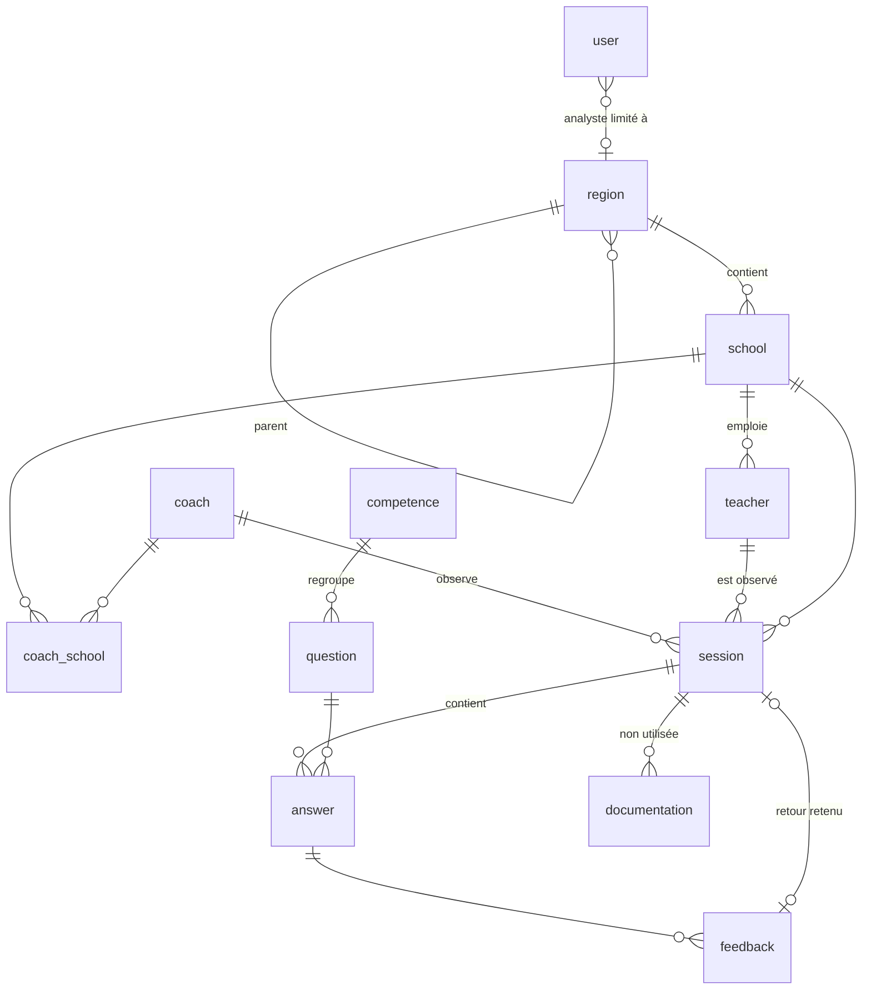
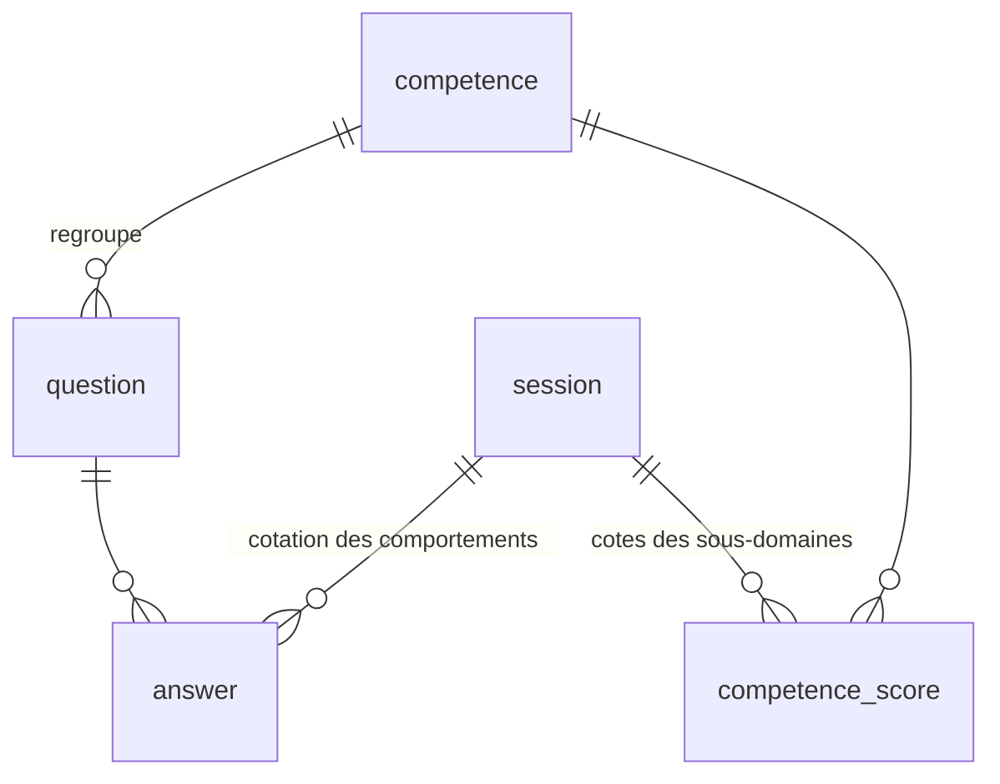
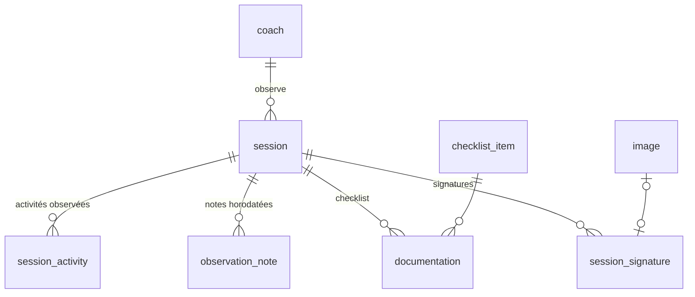
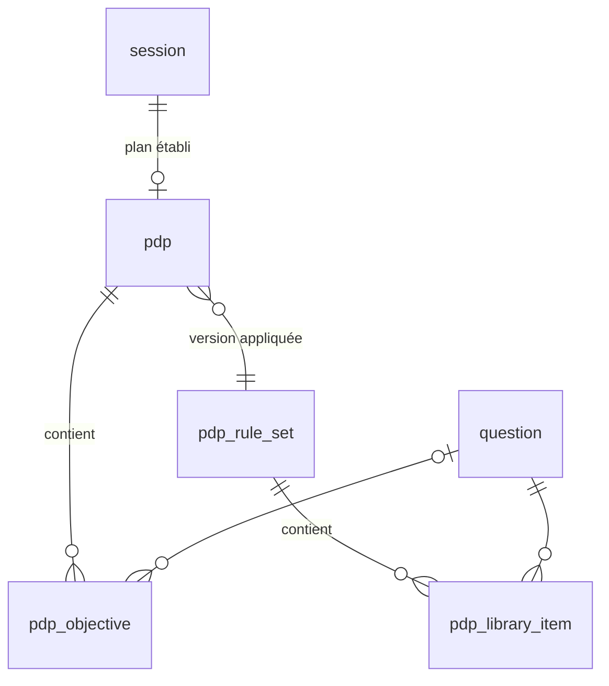
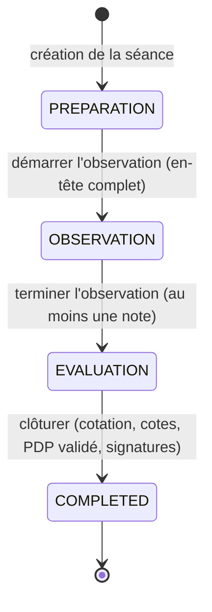

# Modèle de données étendu

Cette page décrit le modèle de données de Coach Digital tel qu'il existe aujourd'hui, puis les extensions nécessaires à l'outil d'observation de classe de la RDC. Elle constitue la partie « modèle de données » du livrable de la phase 2 (architecture technique étendue).

Sources :

- l'audit du code des dépôts `coach-backend` (entités TypeORM, PostgreSQL) et `coach-mobile` (schéma SQLite, service de synchronisation) ;
- l'outil d'observation au format papier (annexe B des TDR) et son manuel d'utilisation (annexe C) ;
- les hypothèses de conception du rapport de cadrage (section 6) et le backlog priorisé (B01 à B32).

## Principes de conception

1. **Étendre plutôt que remplacer.** Les entités existantes (`session`, `competence`, `question`, `answer`, `documentation`, `image`) sont conservées et complétées. Les nouvelles colonnes sont facultatives (`nullable`), de sorte que les données et les écrans existants continuent de fonctionner.
2. **Un même modèle sur le serveur et sur l'appareil.** Chaque table existe à l'identique dans PostgreSQL (serveur) et dans SQLite (application mobile). Les identifiants sont des UUID générés sur l'appareil, ce qui permet de créer des données hors ligne sans conflit. Côté mobile, chaque table garde la colonne technique `_status`, qui indique si la ligne a été synchronisée.
3. **Des référentiels configurables.** La grille (sous-domaines et comportements), la liste des documents à vérifier et les règles du PDP sont des données gérées dans l'administration, et non des valeurs écrites dans le code. Elles sont transmises aux appareils par la synchronisation existante.
4. **Des données de terrain traçables.** Les informations qui peuvent changer après coup sont recopiées dans la séance au moment de l'observation : fonction de l'observateur, version des règles utilisée pour le PDP, diagnostic obtenu. Une modification ultérieure du référentiel ne modifie pas une observation déjà réalisée.

## Modèle existant

Le schéma ci-dessous reprend les entités utilisées par le déroulement d'origine de l'observation, tel qu'hérité de WBG-Coach (Sierra Leone et Népal) ; la version RDC ne conserve que ce qui sert à la RDC.

Constats utiles pour la suite :

- `competence` correspond à un sous-domaine et `question` à un comportement observable. `question.type` vaut toujours `option` et `question.scale` fixe le nombre d'étoiles. Les descriptions des niveaux sont stockées en JSON dans `question.tooltip_data`.
- `answer.value` est un entier ; il n'existe ni réponse Oui/Non, ni « N/A », ni cote globale par sous-domaine.
- `session.session_status` existe dans les deux bases mais n'est jamais renseigné.
- `documentation` existe côté serveur seulement ; elle n'est ni utilisée, ni synchronisée.
- `image` stocke des images en base64 et est déjà synchronisée : elle sera réutilisée pour les signatures.

## Modèle étendu

Les deux schémas ci-dessous montrent les relations ; les colonnes sont détaillées dans la section suivante. Les tables nouvelles sont marquées « (nouvelle) » dans les titres de cette section.

### Grille et cotation

### Déroulement de la séance

### Plan de Développement Professionnel

Toutes les tables, nouvelles ou existantes, gardent les colonnes `created_at`, `updated_at` et `deleted_at` (suppression logique), utilisées par la synchronisation.

## Détail des modifications

### Grille d'observation : `competence` et `question`

La grille de l'annexe B compte six sous-domaines et 30 comportements. Un sous-domaine reste une ligne de `competence`, un comportement une ligne de `question`.

| Table | Colonne ajoutée | Rôle |
| --- | --- | --- |
| `competence` | `code` | Numéro du sous-domaine dans l'outil papier : `I`, `II.1`, `II.2`, `III.1`, `III.2`, `IV` |
| `competence` | `domain_code`, `domain_title` | Domaine de rattachement, pour l'affichage groupé : `II` « Culture de la classe », `III` « Enseignement » |
| `competence` | `display_order` | Ordre d'affichage |
| `competence` | `has_global_score` | Indique si le sous-domaine reçoit une cote globale de 1 à 5 |
| `question` | `code` | Numéro du comportement : `1.1` à `4.6` |
| `question` | `display_order` | Ordre d'affichage dans le sous-domaine |
| `question` | `type` (existante) | Nouvelles valeurs : `YES_NO` (Oui/Non) et `FME` (Faible/Moyen/Élevé). La valeur `option` reste valable pour les grilles existantes |
| `question` | `allow_na` | Indique si la réponse « N/A » est proposée |
| `question` | `tooltip_data` (existante) | Descriptions des niveaux Faible, Moyen et Élevé tirées du manuel, dans le format JSON déjà utilisé par l'aide contextuelle |

Dans l'annexe B, la cote de 1 à 5 figure pour les sous-domaines II.1, II.2, III.1 et IV, mais pas pour I et III.2 : `has_global_score` vaut donc `false` pour ces deux sous-domaines (point à confirmer avec le SERNAFOR).

Répartition des types de réponse selon l'annexe B :

| Type | Comportements |
| --- | --- |
| Oui/Non | 1.1 |
| Oui/Non avec N/A | 1.3 |
| F/M/E avec N/A | 1.2, 2.1.3, 3.2.1, 3.2.3 |
| F/M/E | tous les autres |

### Réponses : `answer`

| Colonne | Rôle |
| --- | --- |
| `value` (existante) | Code de la réponse : pour `YES_NO`, `0` = Non et `1` = Oui ; pour `FME`, `1` = Faible, `2` = Moyen, `3` = Élevé |
| `not_applicable` (ajoutée) | `true` quand l'observateur choisit « N/A » ; `value` est alors vide |

Ce codage garde des entiers dans `value`, ce qui préserve les statistiques et l'export XLSX existants.

### Cote globale des sous-domaines : `competence_score` (nouvelle)

Une ligne par sous-domaine coté et par séance.

| Colonne | Rôle |
| --- | --- |
| `session_id`, `competence_id` | Séance et sous-domaine (couple unique) |
| `suggested_value` | Cote de 1 à 5 proposée par l'application |
| `value` | Cote retenue par l'observateur, de 1 à 5 |

La cote proposée est calculée à partir des comportements cotés du sous-domaine, hors N/A : avec Faible = 1, Moyen = 2 et Élevé = 3, la moyenne `m` donne la cote `arrondi(2 × m − 1)`. Un sous-domaine entièrement faible est ainsi proposé à 1, entièrement moyen à 3 et entièrement élevé à 5. Comme le précise le manuel, la cote n'a pas à être un calcul mathématique : l'observateur peut la modifier, et l'écart entre `suggested_value` et `value` reste visible.

### En-tête et déroulement : `session`

| Colonne ajoutée | Champ de l'outil papier |
| --- | --- |
| `level` | Niveau : PS, P ou S. La grille étant celle du secondaire, l'application enregistre toujours `S` et affiche « Secondaire » sans possibilité de modification ; le champ redeviendra un choix si une grille du primaire est ajoutée |
| `school_year` | Année scolaire (ex. `2026-2027`) |
| `teacher_weekly_load` | Charge hebdomadaire de l'enseignant (heures) |
| `last_observation_date`, `last_observation_rating` | Dernière observation : date et appréciation, reprises de la dernière séance clôturée de l'enseignant à la création de la séance |
| `suggested_appreciation`, `appreciation` (ajoutées) | Appréciation de cette observation : `VERY_GOOD` (très bien), `GOOD` (bien), `FAIRLY_GOOD` (assez bien), `INSUFFICIENT` (insuffisant) ou `WEAK` (faible). L'application la propose à partir de la moyenne `m` des cotes globales des sous-domaines (`m` ≥ 4,5 très bien, ≥ 3,5 bien, ≥ 2,5 assez bien, ≥ 1,5 insuffisant, sinon faible) ; l'observateur la garde ou la change sur l'écran « Conseils et horaires », et l'écart reste visible. Elle devient l'appréciation de la « dernière observation » de la séance suivante |
| `observer_function` | Fonction de l'observateur au moment de la séance (copie de `coach.function`) |
| `start_time`, `end_time` | Heures de début et de fin de la séquence didactique |
| `advice` | Conseils |
| `signed_place` | Lieu (« Fait à ») ; la date est celle de `completed_at` |
| `observation_started_at`, `observation_ended_at`, `completed_at` | Horodatage des changements d'étape |

`session_status` est désormais renseigné (voir [Déroulement de l'observation](#déroulement-de-lobservation)). La colonne existante `subject` porte le champ « Discipline(s) » de l'en-tête ; `objective`, `key_points`, `students_count` et `lesson_time` sont conservées. La discipline et le sujet de la leçon observée sont portés par l'activité observée.

À l'enregistrement de l'en-tête, l'application crée la séance à l'étape `OBSERVATION` (`observation_started_at`). Tant que les notes chronologiques (B13) ne sont pas en place, la cotation se fait directement après l'en-tête et la confirmation de la grille clôture la séance (`COMPLETED`, `observation_ended_at`, `completed_at`). Une séance commencée et non clôturée se reprend depuis la fiche de l'enseignant.

### Activités observées : `session_activity` (nouvelle)

L'outil papier prévoit un tableau « Activité(s) observée(s) », qui peut contenir plusieurs lignes. Chaque ligne devient un enregistrement.

Décision : dans cette version, une fiche d'observation porte sur **une seule activité**, comme elle ne comprend qu'une grille, une heure de début et de fin, un PDP et un jeu de signatures. L'application crée donc une seule ligne `session_activity` par séance. La table est conservée telle quelle afin de pouvoir autoriser plusieurs activités plus tard, si le besoin est confirmé, sans migration des données ni changement de la synchronisation.

La colonne « Sous-domaine » de ce tableau désigne le sous-domaine du programme éducatif (ex. « Mathématiques », avec la discipline « Arithmétique »), et non un sous-domaine de la grille d'observation : elle est donc enregistrée en texte, sans lien avec `competence` (point à confirmer avec le SERNAFOR).

| Colonne | Champ de l'outil papier |
| --- | --- |
| `session_id` | Séance |
| `sub_domain` | Sous-domaine du programme (ex. « Mathématiques ») |
| `discipline` | Discipline |
| `sheet_code` | N° de fiche ou code matrice |
| `class_name` | Classe |
| `p_i` | Colonne « P/I » |
| `time` | Heure |
| `essential_knowledge` | Savoirs essentiels ou sujet de la séquence didactique |
| `display_order` | Ordre de la ligne dans le tableau (toujours 1 dans cette version) |

### Enseignant : `teacher`

Le formulaire de l'enseignant des maquettes ajoute deux colonnes ; le matricule utilise la colonne existante `nin`.

| Colonne ajoutée | Rôle |
| --- | --- |
| `sex` | Sexe : `F` ou `M` |
| `weekly_load` | Charge hebdomadaire (heures), reprise par défaut dans `session.teacher_weekly_load` |

### Observateur : `coach`

| Colonne ajoutée | Rôle |
| --- | --- |
| `function` | `INSPECTOR` (inspecteur), `ADVISOR` (conseiller pédagogique), `SCHOOL_HEAD` (chef d'établissement) ou `PEER` (pair) |
| `sex`, `duty_station`, `postal_box` | Champs de l'en-tête : sexe, poste d'attache, boîte postale. Le téléphone et l'adresse électronique existent déjà |
| `region_id` | Zone d'intervention de l'inspecteur ou du conseiller (à venir avec l'administration, B21) ; en attendant, `duty_station` porte le libellé de la zone saisi à la création du compte |

Ces colonnes sont saisies sur l'écran « Compte observateur » de l'application, envoyées à la création du compte, renvoyées aux appareils à la synchronisation, et reprises dans l'en-tête de la fiche PDF. Le périmètre d'accès découle de la fonction : le chef d'établissement et le pair accèdent aux établissements qui leur sont rattachés (`coach_school`, existant) ; l'inspecteur et le conseiller accèdent aux établissements de leur zone et des zones qui en dépendent (arborescence `region`, existante).

### Checklist documentaire : `checklist_item` (nouvelle) et `documentation` (étendue)

`checklist_item` est le référentiel des 15 documents de l'annexe B. Il est chargé avec la grille (`grille-rdc.json`, B04), puis géré dans l'administration, et transmis aux appareils comme la grille ; l'application en embarque une copie pour fonctionner avant la première synchronisation.

| Colonne | Rôle |
| --- | --- |
| `code` | Numéro du document, de 1 à 15 |
| `owner` | `TEACHER` (documents de l'enseignant.e, 1 à 9) ou `LEARNER` (documents de l'apprenant.e, 10 à 15) : les deux groupes de l'écran |
| `statement` | Énoncé (ex. « L'enseignant.e tient quotidiennement son journal de classe avec clarté ») |
| `document_name` | Nom du document (ex. « Journal de classe ») |
| `display_order` | Ordre d'affichage |

`documentation` reçoit les réponses de la séance :

| Colonne | Rôle |
| --- | --- |
| `checklist_item_id` (ajoutée) | Document concerné (une réponse par document et par séance) |
| `answer` (ajoutée) | `true` = Oui, `false` = Non, vide = non renseigné |
| `proposal` (ajoutée) | Proposition de l'observateur en cas de réponse Non |
| `filled_in_phase` (ajoutée) | Étape à laquelle la réponse a été saisie : `PREPARATION` ou `EVALUATION`. Elle est déduite de l'étape de la séance ; l'observateur n'a pas à la choisir |
| `value` (existante) | Inutilisée, conservée pour compatibilité |

La checklist est remplie en préparation, comme le prévoient les TDR. Ce qui n'a pas pu être vérifié avant la leçon peut être complété en évaluation ; pendant l'observation, la checklist est en lecture seule. Elle ne bloque jamais le déroulement : l'observation peut démarrer avec une checklist incomplète, et la séance peut être clôturée avec des documents non vérifiés, après un simple rappel.

La checklist n'entre dans aucun calcul de cote ni de diagnostic.

### Notes chronologiques : `observation_note` (nouvelle)

Une ligne par note prise pendant l'observation. Les notes sont créées et enregistrées sur l'appareil, sans connexion.

| Colonne | Rôle |
| --- | --- |
| `session_id` | Séance |
| `noted_at` | Heure de l'appareil au moment de la saisie |
| `content` | Texte de la note |

### Signatures : `session_signature` (nouvelle)

Une ligne par signataire prévu par l'outil papier : enseignant, chef d'établissement, observateur.

Règles de signature :

- **l'observateur** signe toujours ; c'est lui qui utilise l'appareil ;
- **l'enseignant** ne peut pas être absent, puisque le PDP est validé avec lui ; il peut en revanche refuser de signer, en indiquant le motif ;
- **le chef d'établissement** est le seul signataire qui peut être absent, en indiquant le motif ;
- **lorsque l'observateur est le chef d'établissement** (`observer_function` = `SCHOOL_HEAD`), il ne signe qu'une fois : aucune ligne `SCHOOL_HEAD` n'est créée et le rapport PDF reprend sa signature dans les deux cases.

| Colonne | Rôle |
| --- | --- |
| `session_id` | Séance |
| `signer_role` | `TEACHER` (enseignant), `SCHOOL_HEAD` (chef d'établissement) ou `OBSERVER` (observateur) |
| `signer_name` | Nom du signataire |
| `image_id` | Image de la signature, enregistrée dans la table `image` existante, déjà synchronisée. Le tracé est conservé en SVG (`data:image/svg+xml`), en bleu stylo (`#1A3FA8`), sans bibliothèque supplémentaire ; il est saisi dans une fenêtre de dessin pour que le défilement de l'écran ne gêne pas le tracé |
| `signed_at` | Date et heure de la signature |
| `refusal_reason` | Motif du refus de signer (enseignant uniquement) ; `image_id` reste alors vide |
| `absence_reason` | Motif de l'absence (chef d'établissement uniquement) ; `image_id` reste alors vide |

### Plan de Développement Professionnel : `pdp_rule_set`, `pdp_library_item`, `pdp`, `pdp_objective` (nouvelles)

Le moteur de règles est une configuration et non du code : le SERNAFOR peut la modifier depuis l'administration, sans intervention d'un développeur.

**`pdp_rule_set`** : une version des règles.

| Colonne | Rôle |
| --- | --- |
| `version` | Numéro croissant |
| `status` | `DRAFT` (brouillon, modifiable), `PUBLISHED` (en vigueur, diffusée aux appareils) ou `ARCHIVED` (remplacée) ; une seule version publiée à la fois |
| `diagnostic_config` | Règles de diagnostic, en JSON : correspondance entre une réponse et une catégorie (Élevé ou Oui → point fort ; Moyen → axe à consolider ; Faible ou Non → axe prioritaire) et seuil de cote, par sous-domaine, en dessous duquel tous ses comportements sont traités en priorité. Version 1 : `{"strength": ["HIGH", "YES"], "consolidate": ["MEDIUM"], "priority": ["LOW", "NO"], "priority_threshold": 2, "due_in_days": 42}`, soit une cote de sous-domaine de 2/5 ou moins et une échéance à six semaines |
| `max_objectives` | Nombre maximal d'objectifs dans un PDP ; 3 dans la version 1, pour concentrer l'effort de l'enseignant sur quelques priorités entre deux visites |
| `published_at`, `published_by` | Date de publication et administrateur qui l'a faite |

**`pdp_library_item`** : la bibliothèque d'objectifs, une ligne par comportement et par version des règles. La version 1 des règles et sa bibliothèque (30 objectifs, avec actions et indicateur) ont été validées par le SERNAFOR. Elles sont chargées avec la grille (`grille-rdc.json`) et embarquées dans l'application, qui génère le projet de PDP sans connexion ; leur modification depuis l'administration relève de B19 et B20.

| Colonne | Rôle |
| --- | --- |
| `rule_set_id` | Version des règles |
| `question_id` | Comportement concerné |
| `objective` | Objectif type |
| `actions` | Actions suggérées, une par ligne |
| `indicator` | Indicateur de suivi |

**`pdp`** : le plan établi à l'issue d'une séance.

| Colonne | Rôle |
| --- | --- |
| `session_id` | Séance (un seul plan par séance) |
| `rule_set_id`, `rule_set_version` | Version des règles appliquée |
| `diagnostic` | Copie du diagnostic obtenu, en JSON : points forts, axes à consolider, axes prioritaires |
| `status` | `DRAFT` (projet généré, en cours d'ajustement) puis `VALIDATED` (arrêté avec l'enseignant) |
| `validated_at` | Date et heure de la validation |

**`pdp_objective`** : un objectif du plan.

| Colonne | Rôle |
| --- | --- |
| `pdp_id` | Plan |
| `question_id` | Comportement visé ; vide pour un objectif ajouté librement |
| `category` | `PRIORITY` (axe prioritaire) ou `CONSOLIDATE` (axe à consolider) |
| `rank` | Ordre de priorité dans le plan |
| `objective`, `actions`, `indicator` | Contenu de l'objectif, repris de la bibliothèque puis ajustable |
| `due_date` | Échéance, proposée à `due_in_days` jours de la séance et modifiable |
| `origin` | `GENERATED` (repris tel quel), `EDITED` (modifié par l'observateur) ou `ADDED` (ajouté librement) |

La table `feedback` existante (retour de coaching sur une pratique) est conservée pour les autres pays. En RDC, l'entretien qui suit l'observation aboutit au PDP : le PDP tient lieu de rapport de coaching, et le flux de coaching existant n'est pas utilisé.

### Rapports PDF

L'application produit deux documents distincts pour une séance clôturée :

| Document | Contenu | Backlog |
| --- | --- | --- |
| Fiche d'observation | Mise en page de l'outil papier : en-tête, activité observée, grille cotée et cotes globales, checklist, heures, conseils, signatures ; notes chronologiques en annexe | B24 |
| Plan de développement professionnel (rapport de coaching) | Document remis à l'enseignant : identification, cotes globales, diagnostic, objectifs, actions, indicateurs, échéances, signatures de l'enseignant et de l'observateur | B25 |

Les deux documents sont produits sur l'appareil à partir des tables décrites ci-dessus ; ils ne sont pas stockés. Ils sont donc disponibles dès la clôture, même sans connexion, et toujours à jour des données de la séance.

- **Génération** : un modèle HTML au format A4 (`src/helpers/report.helper.ts`) est converti en PDF par `react-native-html-to-pdf` (version 0.12, compatible avec l'ancienne architecture de React Native 0.72). Les signatures, enregistrées en SVG, sont reprises telles quelles.
- **Consultation, téléchargement et partage** : l'écran « Documents PDF » affiche les deux documents (`react-native-pdf`). « Télécharger » les enregistre dans Téléchargements › Coach Digital (`react-native-blob-util`, par le magasin de médias à partir d'Android 10, avec l'autorisation d'écriture avant) ; « Partager » ouvre le menu de partage d'Android (`react-native-share`) : e-mail, WhatsApp, Drive, Bluetooth, impression.
- **Accès** : depuis l'écran « Séance clôturée », qui s'ouvre après la clôture et depuis la fiche de l'enseignant.e pour une séance déjà clôturée.
- **Noms des fichiers** : `Fiche_observation_<NOM>_<AAAA-MM-JJ>.pdf` et `PDP_<NOM>_<AAAA-MM-JJ>.pdf`, d'après le nom de l'enseignant.e et la date de clôture.
- Les documents suivent la langue de l'outil papier (français), quelle que soit la langue de l'application.

### Cercles d'apprentissage

Les TDR prévoient de réutiliser les modules complémentaires de Coach Digital. Pour la RDC, seuls les **cercles d'apprentissage (TLC)** sont conservés : une séance collective animée par l'observateur avec un groupe d'enseignants, autour d'une unité de formation (langage positif, objectifs de la séquence, vérification de la compréhension). Le module « communauté de pratique », qui faisait doublon, n'est pas proposé dans l'application de la RDC.

Le contenu des trois unités est rédigé dans le code de l'application mobile, comme aujourd'hui, et adapté au secondaire congolais (B22). Sa gestion depuis l'administration n'est pas prévue ; elle serait utile si le SERNAFOR souhaitait rédiger lui-même de nouvelles unités (évolution possible).

**Recommandation d'unité.** Au début d'un cercle, l'application classe les unités selon les résultats de l'établissement : pour chaque unité, elle compte les observations de l'établissement dans lesquelles le comportement de l'unité (2.1.2, 3.1.5 ou 3.1.7) a été coté Faible, et place en tête, comme « recommandée », l'unité dont le comportement est le plus souvent faible. Elle signale aussi le comportement le plus faible de l'établissement lorsqu'aucune unité ne le couvre. Le calcul est fait sur l'appareil, sans connexion, à partir des tables `session` et `answer` des séances de l'établissement déjà synchronisées ; il ne demande aucune table nouvelle.

Les séances de cercles sont enregistrées dans la table `tlc_evaluation` (sur l'appareil, `TLC_evaluation`, SQLite ne distinguant pas les majuscules). Constat de l'audit : contrairement à ce qu'indiquait l'analyse des écarts (annexe A), cette table n'existait que sur l'appareil. Elle a été ajoutée côté serveur et elle est maintenant envoyée à la synchronisation.

**Liste de présence.** Au début de l'unité, l'animateur coche les enseignants de l'établissement qui participent ; l'écran de fin rappelle leur nombre. Un enseignant absent de la liste peut être ajouté pendant la séance : son nom est ajouté aux participants de la séance, sans créer de fiche enseignant.

| Table | Champ | Description |
| --- | --- | --- |
| `tlc_evaluation` | `unit_id`, `coach_id`, `evaluation` (existants) | Unité, animateur, appréciation de la participation de 1 à 5 |
| `tlc_evaluation` | `school_id` (ajouté) | Établissement où le cercle a lieu |
| `tlc_evaluation` | `participants` (ajouté) | Noms des enseignants présents, en JSON |
| `tlc_evaluation` | `participants_count` (ajouté) | Nombre de participants |

La date de la séance est celle de l'enregistrement (`created_at`). Les participants sont conservés par leur nom, ce qui couvre aussi les personnes ajoutées pendant la séance ; s'il faut un jour suivre la participation enseignant par enseignant dans le tableau de bord, une table `tlc_participant` (`tlc_evaluation_id`, `teacher_id`) pourra s'y ajouter.

Ces données permettent aussi d'afficher, sur la fiche d'un enseignant, les cercles qu'il a suivis (par exemple l'unité 3 lorsque son PDP vise le comportement 3.1.7), et de comparer plus tard la progression des enseignants qui ont suivi une unité ; ces deux usages ne sont pas montrés dans les maquettes.

## Déroulement de l'observation

`session_status` porte la machine à états du déroulement en trois temps décrit par le manuel.

| Étape | Ce qui est modifiable | Condition pour passer à l'étape suivante |
| --- | --- | --- |
| `PREPARATION` | En-tête, activités observées, checklist documentaire | Champs obligatoires de l'en-tête renseignés (la checklist peut rester incomplète) |
| `OBSERVATION` | Notes chronologiques uniquement ; la checklist est en lecture seule | Au moins une note enregistrée |
| `EVALUATION` | Cotation des comportements, cotes des sous-domaines, checklist, conseils, heures, PDP, signatures ; les notes sont en lecture seule | Tous les comportements cotés (ou N/A), toutes les cotes de sous-domaine saisies, PDP validé, signature de l'observateur, signature ou refus motivé de l'enseignant, signature ou absence motivée du chef d'établissement. Les documents non vérifiés de la checklist font l'objet d'un rappel, sans bloquer |
| `COMPLETED` | Rien (séance close) | — |

Aucun retour en arrière n'est possible depuis l'application. Les séances existantes, dont `session_status` est vide, sont considérées comme closes.

## Synchronisation

La synchronisation existante fonctionne par établissement : l'appareil envoie les lignes dont `_status` n'est pas `synced`, puis reçoit les données de l'établissement modifiées depuis la dernière synchronisation, ainsi que l'ensemble de la grille. Les extensions suivent le même mécanisme.

| Données | Sens | Portée |
| --- | --- | --- |
| `competence`, `question`, `checklist_item` | Serveur → appareil | Toutes, à chaque synchronisation (comme la grille actuelle) |
| `pdp_rule_set`, `pdp_library_item` | Serveur → appareil | Uniquement la version publiée |
| `session`, `session_activity`, `observation_note`, `answer`, `competence_score`, `documentation`, `session_signature`, `image`, `pdp`, `pdp_objective` | Dans les deux sens | Séances de l'établissement synchronisé |

Les règles du PDP s'exécutent sur l'appareil : le projet de PDP peut être établi pendant l'entretien avec l'enseignant, même sans connexion. L'application signale une absence prolongée de synchronisation, qui signifierait que les règles utilisées ne sont peut-être plus les dernières publiées.

## Administration

L'interface web lit et modifie ces données par les points d'accès suivants, décrits dans Swagger (`/api/docs`). Tous sont limités à la région de l'utilisateur et à ses sous-régions ; les modifications du référentiel sont réservées au rôle `admin`.

| Point d'accès | Rôle |
| --- | --- |
| `GET /api/dashboard/rdc` | Tableau de bord (B26) : totaux, par fonction de l'observateur, par zone, cotes par sous-domaine, appréciations, mois, comportements des PDP, checklist, cercles |
| `GET /api/session` | Liste des séances avec la moyenne des cotes globales et l'état du PDP |
| `GET /api/session/:id/details` | Séance complète : en-tête, activités, réponses, cotes, checklist, notes, signatures (SVG) et PDP |
| `GET /api/session/export` | Résultats de toutes les séances, pour les fichiers Excel |
| `GET`, `PUT /api/checklist-items` | Checklist documentaire (B12) |
| `GET`, `POST`, `PUT`, `DELETE /api/pdp/rule-sets`, `POST /api/pdp/rule-sets/:id/publish` | Versions des règles du PDP : brouillon, modification, publication, suppression (B19) |
| `GET /api/tlc-evaluations` | Cercles d'apprentissage (B22) |
| `GET`, `PUT /api/coach` | Observateurs avec leurs établissements, leur activité et leur profil (B21) |

Les fiches d'observation et les PDP sont imprimés depuis le navigateur avec la même mise en page que les PDF de l'application, sans service PDF côté serveur. Chaque synchronisation est datée par le serveur, ce qui permet à l'administration de signaler les appareils qui ne se sont pas synchronisés depuis 7 jours.

## Migrations

- **Serveur** : une migration TypeORM ajoute les colonnes et crée les tables ; elle est exécutée par `npm run migration:run`.
- **Application mobile** : une nouvelle migration SQLite (`01`) est ajoutée à la liste existante (`database/migrations`) ; elle s'applique au démarrage, sans perte des données présentes sur l'appareil.
- **Référentiels** : la grille RDC, la checklist et la première version des règles du PDP sont chargées par script (B04) puis administrées depuis l'interface web.

## Correspondance avec le backlog

| Élément du modèle | Backlog |
| --- | --- |
| Grille, types de réponse, aide contextuelle | B04, B05, B06 |
| Machine à états, en-tête, activité observée | B10, B11 |
| Checklist documentaire | B12 |
| Notes chronologiques et verrouillage de la cotation | B13, B14 |
| Cotes des sous-domaines | B15 |
| Conseils, heures, signatures | B16, B17 |
| Règles et bibliothèque PDP, administration, diffusion | B18, B19, B20 |
| Fonction de l'observateur et périmètre d'accès | B21, B26 |
| Génération du PDP | B23 |
| Rapports PDF (fiche d'observation, PDP) | B24, B25 |
| Cercles d'apprentissage | B22 |

## Points à confirmer avec le SERNAFOR

1. **Nombre de comportements** : 30 dans l'outil et le manuel, 29 dans les TDR. Le modèle suit l'outil.
2. **Cote globale** des sous-domaines I et III.2 : absente de l'annexe B.
3. **Colonne « P/I »** du tableau des activités observées : signification à préciser.
4. **Liste figurant à droite de l'en-tête** (Intéressé, Établissement, IGE, IPP, Pool, Proved, Gestionnaire, A.T./Bourgm., S/Proved, Classement) : s'il s'agit de la liste de diffusion de la fiche, elle relève du rapport PDF et non de la saisie.
5. **Colonne « Sous-domaine »** de l'activité observée : sous-domaine du programme éducatif (hypothèse retenue) ou sous-domaine de la grille.
6. **Bilan des objectifs du PDP précédent** : évolution possible, hors TDR, à décider.
7. **« Segments » et « étapes 1 / 2 »** mentionnés par le manuel (repris du cadre TEACH) : avec une seule activité par fiche et une cotation globale, il s'agit d'une question de vocabulaire, sans effet sur l'application.
8. **PDP et coaching** : le PDP tient lieu de rapport de coaching (hypothèse retenue). Des séances d'accompagnement entre deux observations, sans nouvelle cotation, ne sont pas prévues.
9. **Animation des cercles d'apprentissage** : chef d'établissement, conseiller pédagogique ou inspecteur.
10. **Fonctions des observateurs** : le manuel cite aussi le Directeur des études et le Conseiller d'enseignement, absents des quatre fonctions prévues par les TDR.
11. **Synchronisation des cercles** : à ajouter si leurs séances doivent remonter dans l'administration et le tableau de bord.
12. **Communauté de pratique** : non proposée dans l'application de la RDC (doublon avec les cercles) ; à signaler au SERNAFOR, le module étant cité dans les TDR.
13. **Liste de présence des cercles** : ajout non prévu explicitement par les TDR (établissement, date et enseignants présents), proposé pour suivre les cercles par établissement ; il n'est utile au niveau de l'administration qu'avec la synchronisation des cercles (point 11).
